

  

<h1 align="center">
  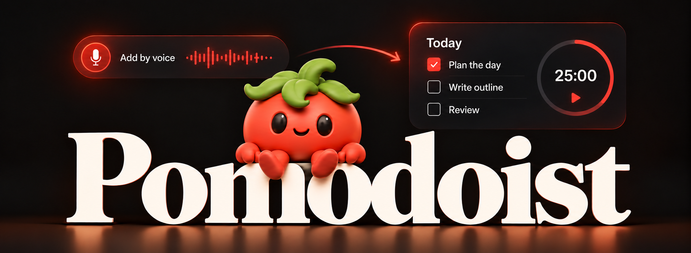
</h1>

  <strong>A little focus. A better day.</strong>

  Plan tasks. Protect focus time. See your progress. 
  An open-source productivity app for work, study, and everything in between.

  <a href="#meet-pomo-your-desktop-companion">Meet Pomo — your animated 3D desktop companion.</a>

  
  

  macOS · iPhone &amp; iPad · Android · Windows · Linux · Web

  <a href="https://pomodoist.com">Website</a> ·
  <a href="https://pomodoist.com/privacy/">Privacy</a> ·
  <a href="https://github.com/Kabanya/Pomodoist/issues/new">Report a bug</a> ·
  <a href="CONTRIBUTING.md">Contribute</a>

  <a href=".github/assets/readme/product-overview.webp">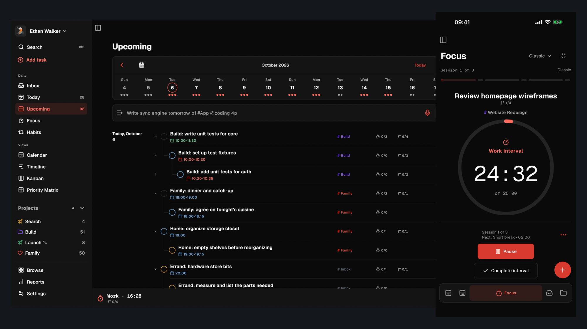</a>

## Plan your day

Capture tasks, organize your schedule, and keep everything in one place.

- Quick task capture
- Inbox, Today, Upcoming, and projects
- Calendar, timeline, kanban, and priority matrix

  <a href=".github/assets/readme/quick-add.gif">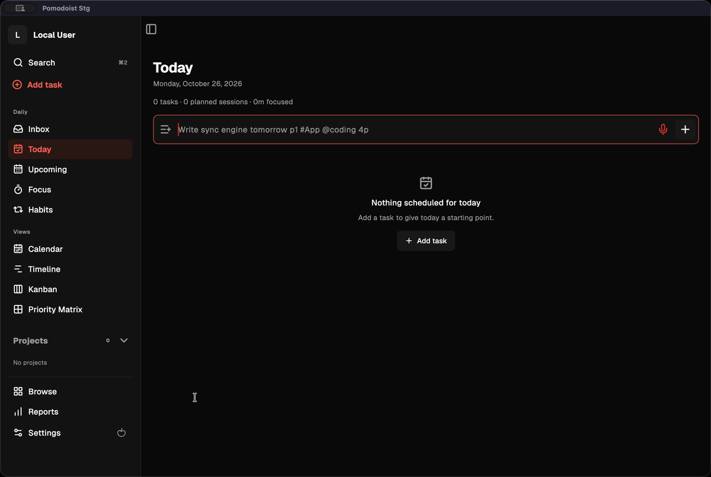</a>
   
  Capture a task, set its priority, and estimate the effort as you type. <a href=".github/assets/readme/macos-plan.webp">View the static screenshot</a>.

## Focus on what matters

Work through Pomodoro sessions with configurable breaks and deep-focus tracking.

- Configurable work and break intervals
- Track focus time as you work
- Review progress in the app

  <a href=".github/assets/readme/focus-session.gif">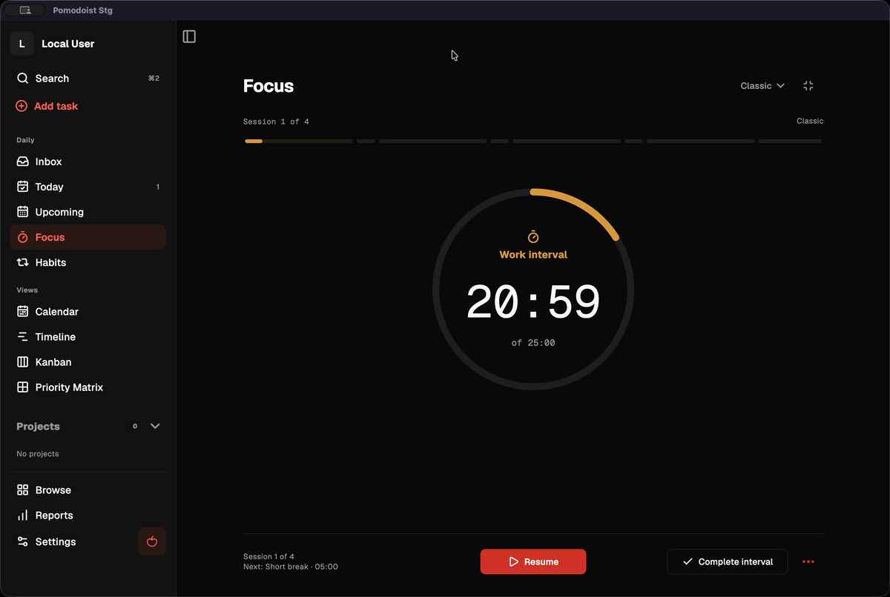</a>
   
  Your full focus session: timeline, countdown, and interval controls. <a href=".github/assets/readme/macos-focus.webp">View the static screenshot</a>.

## Meet Pomo, your desktop companion

Pomo is an animated 3D mascot that lives on your desktop while you work.
He follows your focus sessions, rests during breaks, and celebrates completed tasks.

- See your remaining focus time and control sessions from the desktop
- Start, pause, or resume focus and quickly add a task from Pomo's controls
- Move and resize Pomo, show him only during focus, or choose quiet and reduced-motion modes

  
  
  
   
  Focus · Take a break · Celebrate

  <a href=".github/assets/readme/desktop-pomo.gif">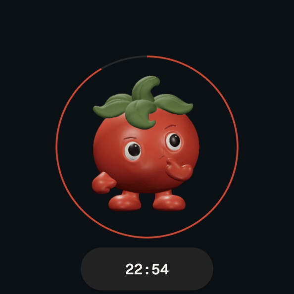</a>
   
  Recorded from the macOS desktop companion. <a href=".github/assets/readme/desktop-pomo-poster.webp">View a still frame</a>.

Enable Pomo in **Settings → Pomo**.

## Work together

Share tasks, keep comments beside the work, and see your team's focus time.

  
   
  <a href=".github/assets/readme/macos-shared-task-comments-full.webp">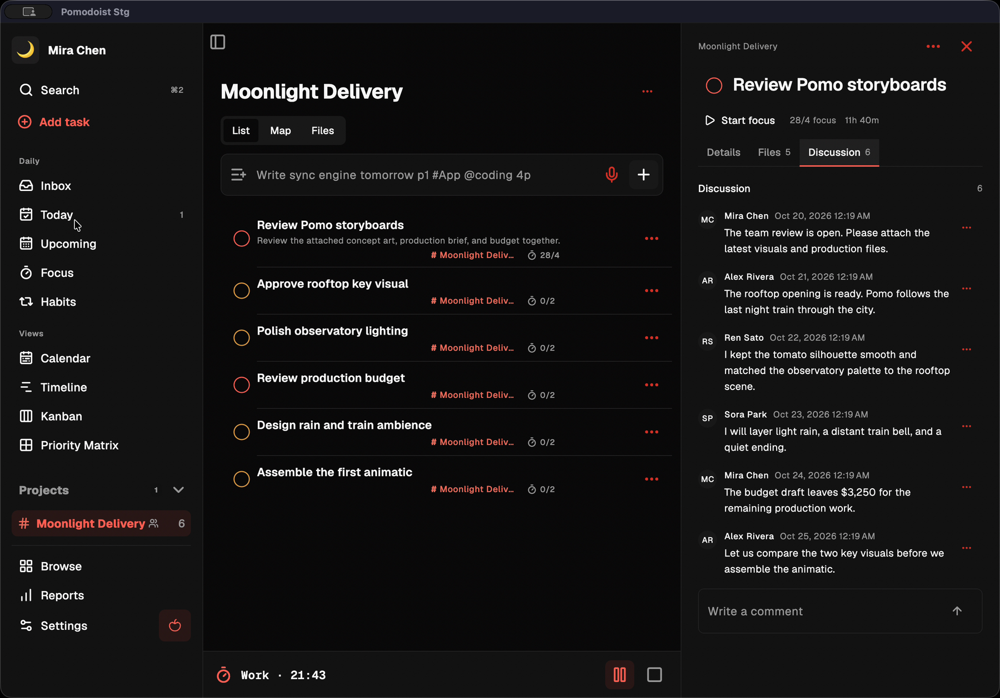</a>
   
  Shared task discussion in the macOS app, using fictional demo data. Click the screenshot to enlarge.

**Self-hosted is fully free.** Run Pomodoist on your own infrastructure with your own accounts and provider credentials; infrastructure and provider costs are yours. The official app uses Pomodoist's hosted infrastructure, with free features and paid services or account entitlements. Subscriptions support those hosted services; the source code and official client binaries remain AGPL-3.0-only. See [Licensing](LICENSING.md).

## See your progress

Review your focus time and productivity trends with built-in reports.

- Weekly focus-time trends
- Completed tasks and focus intervals
- Habits alongside your daily work

  <a href=".github/assets/readme/macos-reports.webp">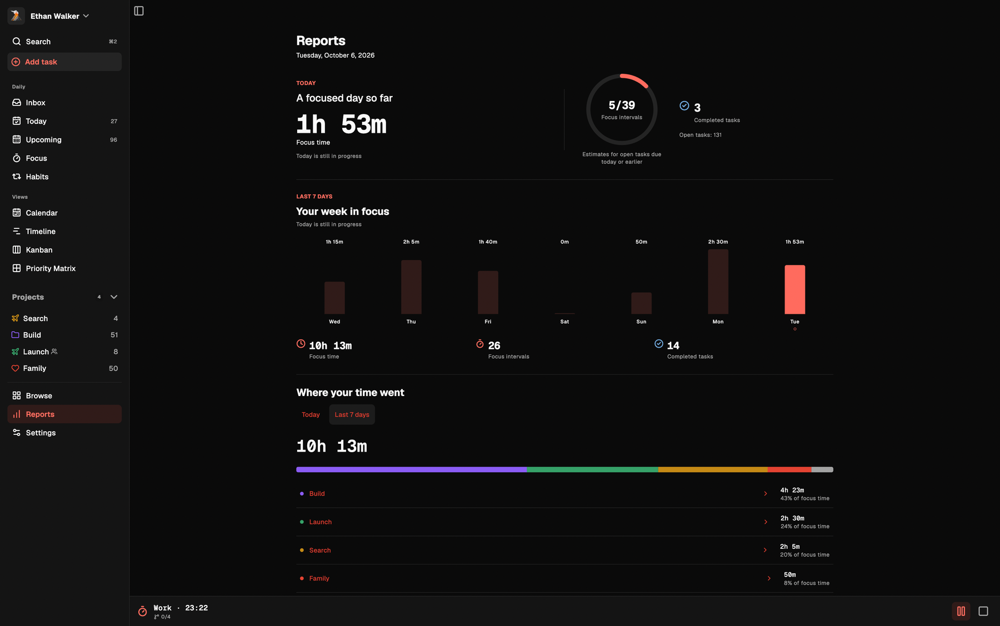</a>

## More ways to work

<strong>Explore more features and macOS and iPhone screenshots</strong>

Choose a view for the work in front of you. Click any screenshot for a closer look.

### macOS

<table>
<tr>
<td width="50%" valign="top"><a href=".github/assets/readme/macos-kanban.webp">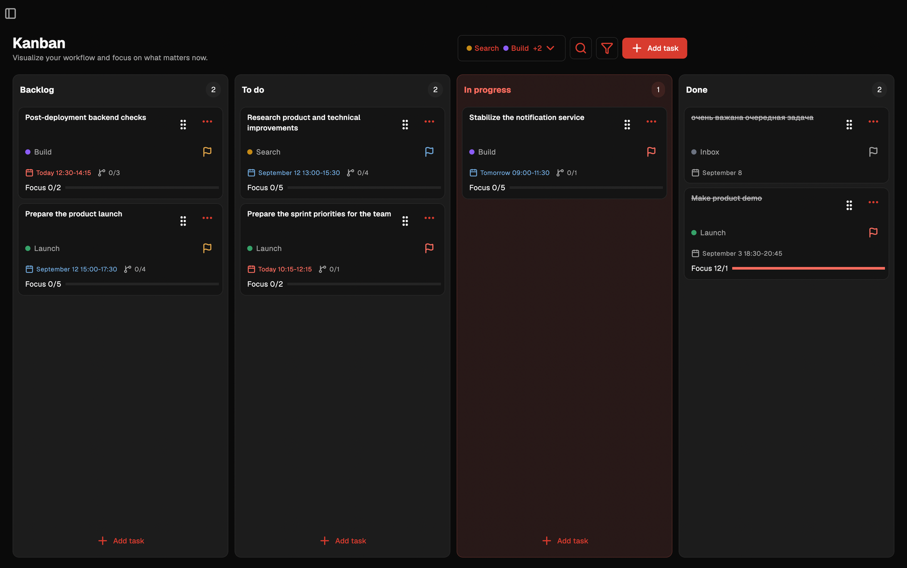</a> <b>Kanban</b> Move cards between statuses, reorder your next actions, and hide completed work to keep the board focused.</td>
<td width="50%" valign="top"><a href=".github/assets/readme/macos-matrix.webp">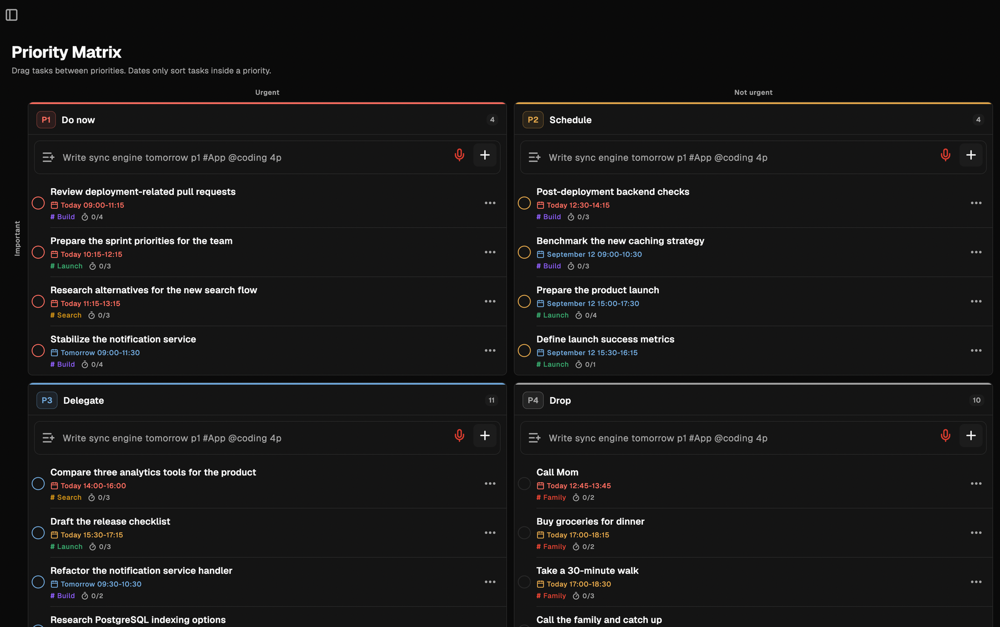</a> <b>Priority Matrix</b> Compare urgency and importance in four quadrants. Move tasks between them as priorities change.</td>
</tr>
<tr>
<td width="50%" valign="top"><a href=".github/assets/readme/macos-calendar.webp">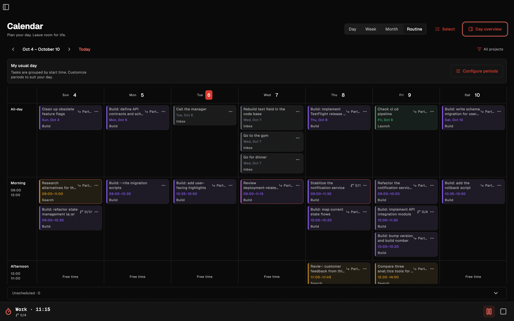</a> <b>Calendar</b> Plan in day, week, or month views. Drag tasks into your schedule while keeping all-day and unscheduled work in view.</td>
<td width="50%" valign="top"><a href=".github/assets/readme/macos-timeline.webp">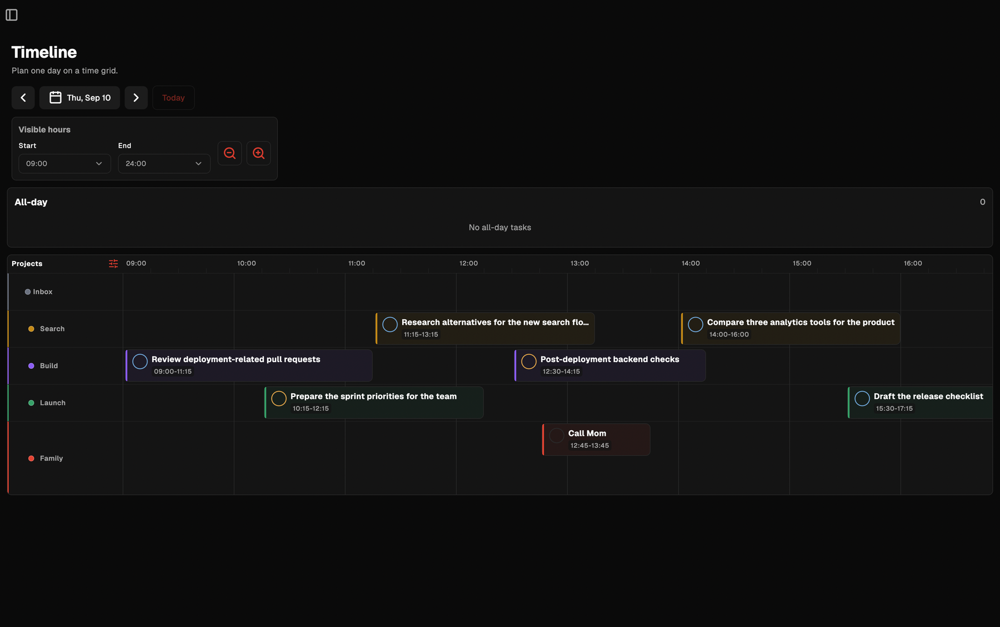</a> <b>Timeline</b> See upcoming tasks in chronological order and review how your plans are spread across dates.</td>
</tr>
<tr>
<td width="50%" valign="top"><a href=".github/assets/readme/macos-habits.webp">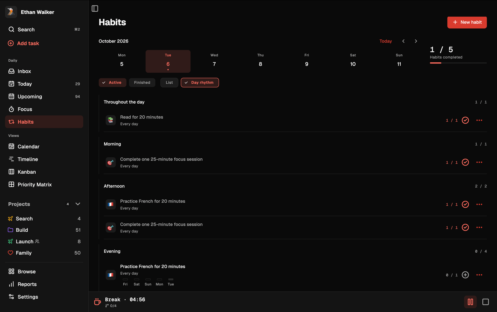</a> <b>Habits</b> Build personal routines with daily goals, partial progress, and a history you can review by day.</td>
<td width="50%" valign="top"><a href=".github/assets/readme/macos-search.webp">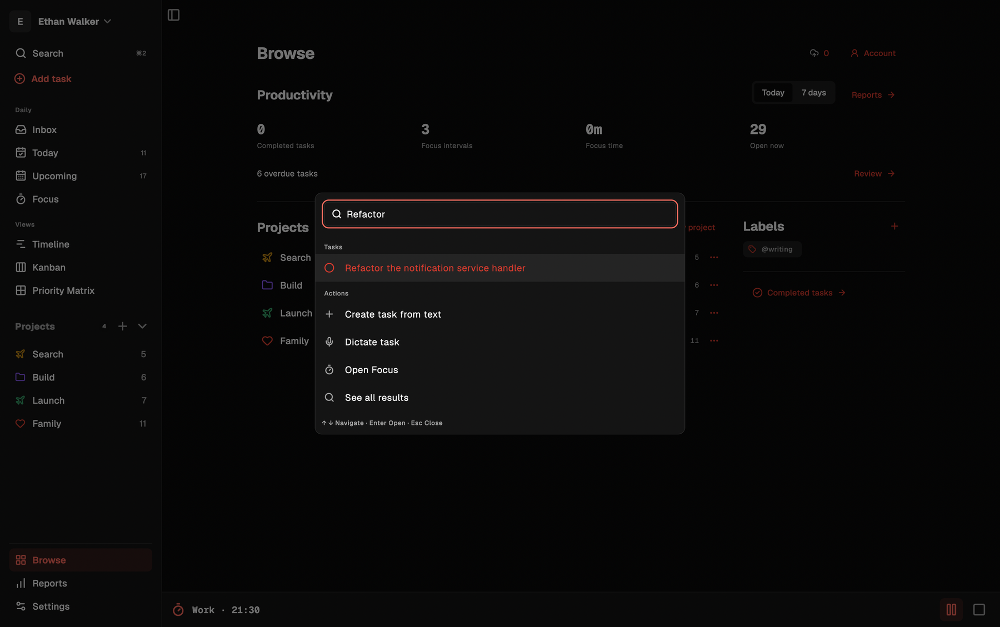</a> <b>Search</b> Find tasks by title or description. Filter by project and include open tasks, completed tasks, or both.</td>
</tr>
</table>

### iPhone

<table>
<tr>
<td width="50%" valign="top"><a href=".github/assets/readme/iphone-plan.webp">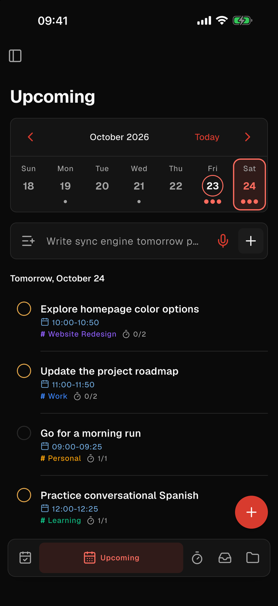</a> <b>Plan on iPhone</b> Review upcoming tasks and keep your daily plan close at hand.</td>
<td width="50%" valign="top"><a href=".github/assets/readme/iphone-focus.webp">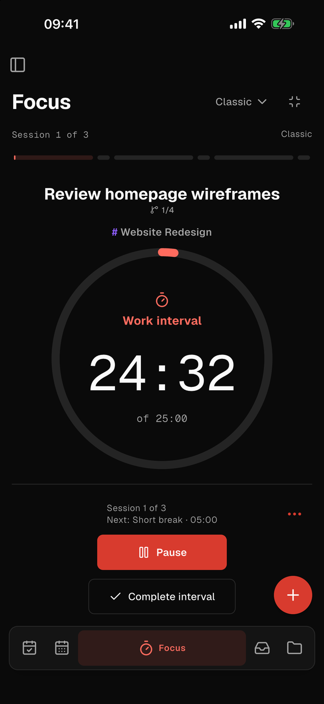</a> <b>Focus on iPhone</b> Start a focus session from your phone and keep the timer in view.</td>
</tr>
<tr>
<td width="50%" valign="top"><a href=".github/assets/readme/iphone-reports.webp">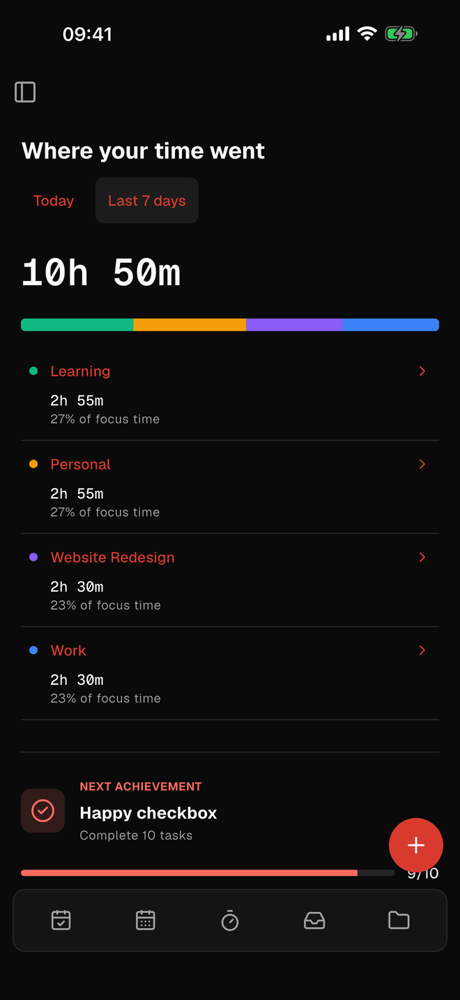</a> <b>Reports on iPhone</b> Review your focus time and productivity when you are away from your Mac.</td>
<td width="50%" valign="top"><a href=".github/assets/readme/iphone-habits.webp">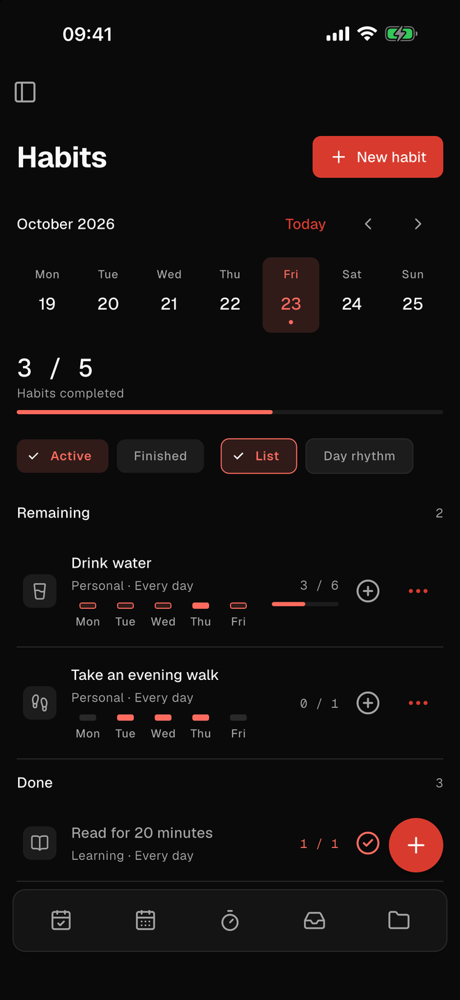</a> <b>Habits on iPhone</b> Record daily progress and keep your routines going on the move.</td>
</tr>
</table>

## Open source. Open to you.

Explore the code, run your own instance, or help improve Pomodoist.

[Self-hosting](https://pomodoist.com/docs/self-hosting/) ·
[Build from source](#build-from-source) ·
[Contribute](CONTRIBUTING.md) ·
[AGPL-3.0-only](LICENSE)

## Build from source

Run `make setup` and `make check` from the repository root. Flutter lives in
`apps/flutter`; the pinned SDK and environment profiles remain at the root.
See the [repository architecture](https://pomodoist.com/docs/repository/) and
[compatibility and release sequence](https://pomodoist.com/docs/compatibility/).

Detailed build, self-hosting, and platform-specific instructions are available in the documentation:

- [Introduction](https://pomodoist.com/docs/): App overview, key features, and documentation navigation
- [Self-hosting](https://pomodoist.com/docs/self-hosting/): Docker setup, HTTPS, email, integrations, backups, and updates
- [OpenClaw integration](https://pomodoist.com/docs/integrations/openclaw/): Standalone skill, OAuth setup, tasks, synchronized Focus, and ClawHub publication
- [Flutter quickstart](https://pomodoist.com/docs/quickstart/): FVM setup, environment generation, validation, and local development
- [System requirements](https://pomodoist.com/docs/installation/system-requirements/): Flutter SDK and platform-specific build toolchains
- [Linux and Windows builds](https://pomodoist.com/docs/installation/desktop/): Desktop prerequisites, development, and release builds
- [Configuration reference](https://pomodoist.com/docs/configuration/reference/): Environment files and client configuration
- [Developer guide](https://pomodoist.com/docs/developer-guide/): Repository layout, Make targets, testing, migrations, and contributing
- [Email address operations](https://pomodoist.com/docs/configuration/email-addresses/): Add incoming Cloudflare routes and outgoing Brevo senders
- [Telegram Mini App development](https://pomodoist.com/docs/integrations/telegram-mini-app/#local-development): `make telegram-debug` with real staging accounts and `make telegram-release`
- [Chrome extension development](https://pomodoist.com/docs/integrations/chrome-extension/#make-commands): `make chrome-debug` and `make chrome-release`

## Contributing

Bug reports and focused pull requests are welcome. Open an
[issue](https://github.com/Kabanya/Pomodoist/issues/new) before starting a
substantial change, read the [contribution guide](CONTRIBUTING.md), and run
`make check` before submitting a pull request.

## License

Copyright © 2026 FinchForge LLC.

Pomodoist source, including `server/`, and official client binaries are licensed under the
[GNU Affero General Public License v3.0 only](LICENSE) (`AGPL-3.0-only`). See
the [licensing model](LICENSING.md). Paid subscriptions cover hosted services
and account entitlements, not a proprietary client license. The name, logo,
and app icon follow the
[trademark policy](TRADEMARKS.md), and contributions require the
[Contributor License Agreement](CLA.md).

<strong>Project status</strong>

  
  

